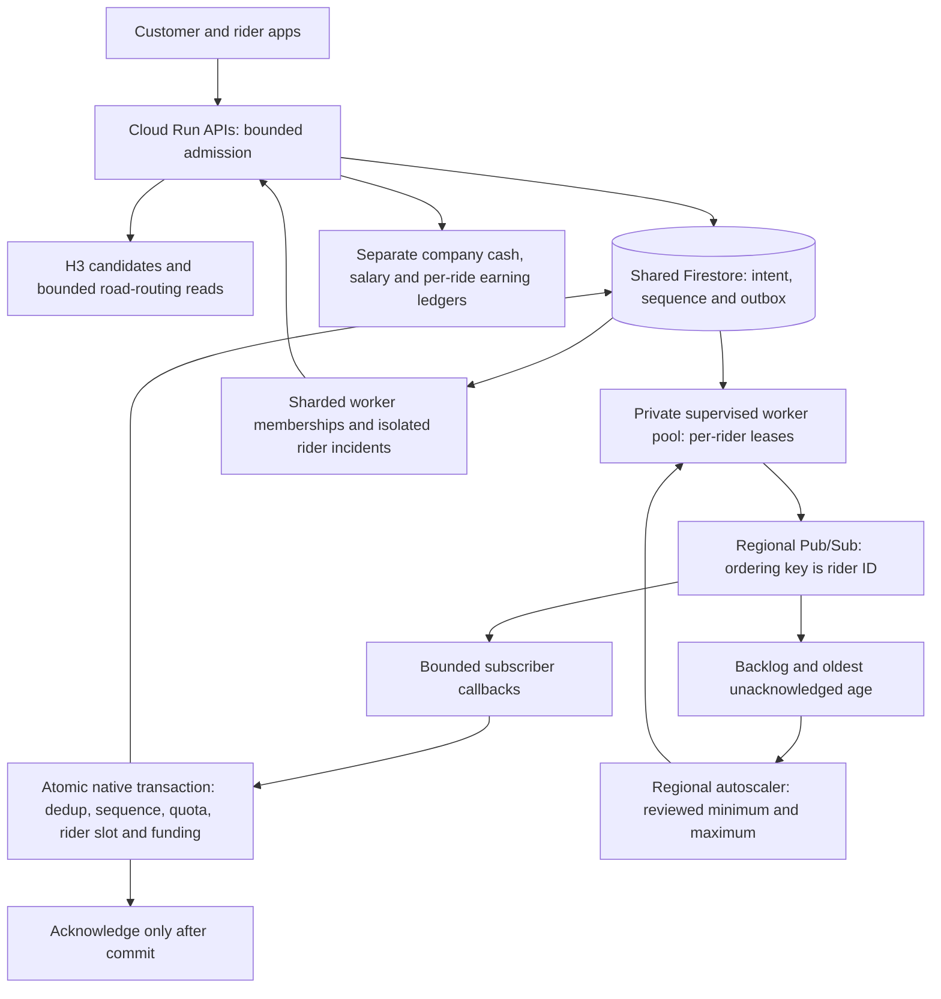

# Bike growth, earnings and resilience — 19 October 2026

This batch prepares the rider growth model, bounded recovery and deployment
configuration. **It has not provisioned infrastructure, changed live capacity,
deployed code or activated independent rider compensation.** A clean release
must follow the existing explicit-release procedure.

## Architecture



Pub/Sub supplies ordered key delivery and subscriber work distribution. Firestore
transactions remain the booking authority. This provides idempotent native
effects despite at-least-once delivery; it does not claim two separate systems
offer end-to-end exactly-once delivery. Adding a rider creates native records
and a new ordering key, not infrastructure dedicated to that rider.

## Independent rider compensation

The initial salaried roster stays separate: at most three active riders at
₹7,000 per earned month. Additional riders can apply for an independent plan:

- Company-reviewed percentage of a paid fare **before tax**, including its
  accepted surcharge, rounded down to integer paise.
- Fixed company-funded earning for each qualifying free launch ride.
- Explicit rider acceptance of the current terms and separate company approval
  of the rider's documents and independent agreement.

**No actual percentage or free-ride payout was specified.** Both default to
zero and the plan defaults to disabled. Browser/HTTP fixtures use sample amounts
only; those fixtures do not establish production compensation. New independent
assignments require reviewed positive paid earnings and current consent.

Company → Transport → Bikes → Independent riders provides compact policy,
funding, applications and per-rider ledgers. Financial records load on deliberate
expansion. Tables use bounded server pages and identify loaded records. Decisions
use optimistic versions; a rejected or suspended rider can be reopened for
review without being approved automatically. Changed earning amounts or terms
require new consent before future work; pausing alone keeps the accepted terms
version. A salaried assignment and an approved independent agreement cannot
overlap. Already accepted journeys retain their agreed earning and can finish
through a policy pause while physical approvals remain valid.
Pausing or underfunding salary operations does not end salary membership; that
rider must be explicitly offboarded before independent enrolment or approval.

For promotional rides, exact company funds are reserved atomically with the
native rider slot. Sixteen funding buckets spread ordinary writes. A bounded
split claim handles fragmented final balances; concurrent transactions cannot
spend the same funds. Cancellation releases a reservation and verified completion
commits it to an immutable per-ride earning credit. No free quote is silently
made payable by the customer when funding runs out.

For paid rides, collected fares are company cash held by the rider. The agreed
earning initially awaits company cash receipt. A reviewed company receipt makes
that credit payable. An operator records a real external earning transfer against
exact owned payable credits; the rider separately confirms receipt. Stable
request IDs, unique normalized references and atomic credit claims prevent
duplicate records or double allocation. These APIs **do not initiate bank
payments**. Salaries, company cash and independent earnings have separate ledgers.

Company cash totals now sum sixteen signed delta shards plus the pre-sharding
baseline. Rider/month invariants still reject over-remittance. Earlier balances
and offboarded riders remain in the exact total; history pagination never defines
a financial total.

## Recovery and bounded load

Worker membership uses 16 bounded shards, one member per running process. A
departing or broken worker cannot overwrite a healthy peer's readiness. Membership
requires the matching transport fingerprint and a heartbeat within 60 seconds;
workers refresh every 20 seconds. Overlapping backlog samples are not added.
The admin distinguishes healthy/degraded workers and marks the sampled outbox
number as a lower bound. Real broker lag remains unavailable until measured.

Each worker reconnects its SDK with bounded exponential jitter. The relay uses
per-rider leases, a process-local cursor and a per-pass time budget. It advances
only through attempted keys, preserving fairness when I/O is slow. A failed rider
event blocks only that rider's new offers. Redelivery retries the durable record
and the matching successful event clears the incident. Admin recovery records
are read-only; there is no unsafe skip or “clear error” button.

Private `/livez` and `/readyz` distinguish failed startup, a hung loop and a
temporary broker outage. The prepared runtime adds process restarts and managed
instance autohealing. A leased, bounded maintenance pass recovers expired offers
and slots, accrues salary records and advances review projections. It does not
replace other platform notification schedules.

Journey and pickup routing use separate shared thread pools: four concurrent
requests and eight pending slots in each pool. Equal precise routes coalesce.
Caches have short TTLs, bounded entries and a 4 MiB serialized-payload ceiling
per pool; the providers also cap route sizes. Three dependency failures open a
short circuit, with a bounded recovery probe. Optional pickup ETA failures keep
their estimate label; booking still requires a verified journey route. No fare,
entitlement, account, funding decision or reservation lock is cached here.

Stationary GPS updates renew native freshness without rewriting the shared H3
cell-version record every time. Discovery remains a bounded candidate sample,
with fresh approval/slot checks. Rider polling backs off and jitters, pauses while
hidden/offline and resumes on reconnect. GPS posts reuse their actual response
instead of triggering two redundant reads. Transient telemetry failures retry;
stale or inaccurate GPS still cannot establish arrival. The active ride shows a
compact map, current action, quiet secondary controls and the agreed earning.
Business suite state is explicitly keyed by the authenticated account.

Shared API reads retry only GET/HEAD on 429/502/503/504, at most twice, within
their existing deadline and cancellation signal. Writes retain their explicit
version/request-ID receipt flows and are never automatically retried. Private
bike read snapshots live only briefly in account-scoped memory. Stable vendor
chunks improve reuse across releases; the main entry chunk remains large.
Splitting vendors does not by itself reduce the total cold-download bytes.

## Catalogue review migration

Catalogue ratings no longer scan lifetime job history. Verified completed reviews
project to idempotent per-job facts and sixteen counters per service. Edits,
service changes and reopened jobs adjust the same transaction. Reads briefly
cache only these review aggregates; prices remain fresh.

Existing jobs backfill by document-ID cursor, at most 64 per pass, with throttling.
The API and bike worker advance this bounded cursor. Until complete, the API
returns `ratings_indexing=true` and the UI shows “Reviews updating” rather than
false partial averages or “no reviews”. Inspect the native
`ops_catalog_rating_projection/v1` state and its `ready` field during release.
For large histories, advance bounded batches using the reviewed backend runtime
before promoting traffic. Do not mark the projection ready manually or rebuild
it by deleting live review facts.

## Release and operational limits

Use the prepared [private worker pool](../infra/bike-runtime/README.md) and
[API capacity planner](../infra/api-capacity/README.md). Default worker capacity
is 2–16 across two zones, scaling from Pub/Sub backlog. Proposed API caps are
64 main / 40 work instances at concurrency 24. These values are reviewable
ceilings, not current production settings or throughput guarantees. Minimum
instances incur charges. Check actual cloud quota and budget before enabling.

For a requested release:

1. Review and release the matching API image, worker code and frontend. Confirm
   production indexes, existing resource ownership and a protected remote
   Terraform state. Preserve all native records and existing delivery schedules.
2. Provision only the reviewed resources. Bind the same stable quota key on API
   and worker, using a pinned numeric Secret Manager version; test ADC, private
   image pull, both zones and real ordered delivery. Do not enable independent
   work until all serving writers understand its funding and earning records.
3. Observe review projection completion and use staged API health checks. Any
   edge/DNS/ingress change needs its own reviewed cutover, CORS and Android checks.
   Private API and tracking responses must never use a public CDN cache.
4. Enter real compensation, operating, tax and promotion terms; collect explicit
   rider consent, approve documents and verify company funding. Enable new bike
   bookings only after these checks and actual transport readiness succeed.
5. Exercise broker disconnection/redelivery, a worker kill/replace, one-zone loss,
   concurrent quota/funding requests, a queued next trip and GPS/OTP journeys on
   real devices. Test actual SMS and external cash/transfer evidence separately.
6. Ramp traffic while monitoring p95/p99, busy responses, queue age, transaction
   retries, provider errors/quotas, memory, instance ceilings and spend. A capped
   overloaded service returns retryable busy responses instead of unbounded work.

During incidents pause new bookings, retain active-trip support and financial
ledgers, and keep compatible consumers running. Roll back only to code that
understands existing independent reservations; pre-earnings code cannot safely
finish these records. Prefer a compatible roll-forward when necessary. Do not
purge the subscription/outbox or destroy infrastructure as a code rollback.

This source and the local results below do not guarantee zero downtime, no lag,
unlimited throughput or absence of customer complaints. Managed scaling takes
time and cannot remove provider, database, network, policy or budget limits.

## Verified local evidence

| Check | Observed result |
| --- | --- |
| Full backend regression | 1,701 passed, 32 skipped; final recovery/source refinements also receive focused checks. Optional external/emulator configurations account for the skips. |
| Final core/earnings/cash/catalogue/capacity/source checks | 103 passed. |
| Final dispatch/recovery checks | 49 passed, including slow-I/O fairness, pinned secret integrity and reconnect/probe behavior. |
| Final compensation lifecycle checks | 70 passed, including the paused-salary membership guard, independent credits and existing paid/free journeys. |
| Native Firestore | 7 passed with anonymous credentials against loopback demo projects; includes independent funding completion and competing reservations. |
| Frontend unit suite | 367 passed. |
| Rider browser checks | 320–768px, current/next ride, map fullscreen/Escape, visible 44px ride controls, light/dark, 200% text, WCAG A/AA scans; reconnect, OTP recovery, fresh GPS, one-shot audio, salary receipt and company cash reporting. |
| Company and independent browser checks | Policy versions, explicit funding/review, exact credit transfer, rider receipt and revised-term consent; 320–1440px, light/dark and 200% text with no detected WCAG A/AA violations. Actual submitted payloads validate against backend schemas. |
| Fullstack browser | Customer UI through a real local HTTP API: another passenger, free/paid routes, native reservation, GPS/OTP lifecycle and exact company cash receipt. Identity and external route boundaries use isolated fixtures. |
| Terraform | Validate passed and 5 mocked-provider tests passed; zero cloud resources created. |
| cPanel build | TypeScript and actual Vite website target pass. Existing large-chunk warnings remain. |
| Dispatch replay harness | 128 riders, 8 local workers, 512 logical events; 76 lost publish acknowledgements and 4 failed callbacks recovered; each sequence applied once. Last run 2.65s, commit-plus-replay p50/p95/p99 2.14/54.49/111.40ms. |
| Work API HTTP harness | 32 authenticated local accounts, 400 fixture projects, concurrency 24, 1,164 requests in 10.21s; all HTTP 200, no relevance/privacy failures; p50/p95/p99 54/999/1789ms. |

The load runs use temporary SQLite and a shared five-CPU development machine.
The dispatch broker is an in-memory fault-injecting adapter. They establish local
correctness and expose tail latency, not GCP capacity, zone resilience, real
Pub/Sub delivery or a production SLA. Reproduce without any remote target:

```sh
backend/.venv/bin/python scripts/bike_dispatch_load.py --riders 128 --workers 8
backend/.venv/bin/python scripts/work_api_load.py --concurrency 24 --accounts 32 --catalog-size 400
```
