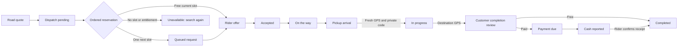

# Bike pilot: business rules and activation

Company-operated bike booking lives in Market → Rides → Bike, with customer
history, approved rider workspaces and company transport administration.
Deploying the application and opening bookings are separate steps. Check the
live policy and company launch checklist, then follow the
[controlled launch runbook](BIKE_LAUNCH.md) to complete dispatch and operator setup.

## Launch contract

| Rule | Initial behavior |
| --- | --- |
| Geography | Both stops inside an explicitly reviewed Balasore operating circle; this is not an asserted municipal boundary. |
| Journey | Confirmed two-wheeler road distance up to 4 km. Admin can later review a limit up to 8 km. |
| Pickup search | Up to 4 km, including an eligible busy rider's finishing destination. |
| Paid fare | Internal ₹8 base + ₹5/km, integer paise. No per-minute launch charge. Customers and riders see the accepted total, applicable surge and settlement terms. |
| Promotion | Eligible road trips up to 2 km, up to three rides per ISO week in India time, 36 hours between free uses, six calendar months from the locked launch date. |
| Identity | Free allowances belong to the authenticated booker's verified mobile, including bookings for another passenger. Passenger contact fields never establish entitlement. |
| Rider model | Up to three approved company riders at ₹7,000 per earned month, plus separately approved independent riders on a reviewed per-ride agreement. The independent plan defaults to disabled with zero amounts until configured. |
| Collection | Initial paid flow is cash after the journey. A customer's report remains pending until the assigned rider confirms the exact amount. |
| Cancellation | No charge before pickup. Started-ride or collection disputes require review; a reported collection is not silently erased. |

Routes, final fare and terms are reviewed before booking. A free quote is never
silently converted to a paid ride. Campaign marketing is brief; account-specific
eligibility shows the truthful next eligible time when applicable. Verification
can refresh the available quotes, but the customer must review and request one.

The mobile quota uses a dedicated keyed HMAC, not a public phone hash or a raw
phone number. The same verified mobile cannot obtain a new allowance merely by
using another account. This is mobile-based eligibility, not a claim to prove
one natural person across multiple mobile numbers. Verified Firebase identity
claims are checked on the server. Account access still scopes all private rides.

Shared bike journeys reuse the existing published-departure, request, acceptance,
pickup and completion flow, filtered to bikes with one passenger seat. A shared
journey has its published agreed fare; this company free-ride campaign applies to
the new on-demand bike flow. Unsupported self-drive bike rental is not offered.

## Reservation and journey lifecycle

Server stream order determines priority. Looking at a card or keeping a screen
open gives no priority. A pending request promises neither a rider slot nor a
free allowance. The ordered consumer reserves quota and the physical rider/vehicle
slot in the same database transaction. Each rider has at most one current and
one future reservation. A next slot is offered only when an in-progress ride is
expected to finish within 15 minutes. Riders still accept requests; ETA is an
estimate, not a guaranteed pickup time.

Before starting, a server-fresh GPS reading must be within 300 m of pickup and
the customer supplies the private pickup code. Failed code attempts are bounded.
Completion also requires the destination geofence. Fresh arrival cues turn green;
optional sounds ring once per event. Old or unavailable GPS is not presented as
live. Exact journey coordinates and passenger contacts are visible only to the
authorized booking account and assigned operator. Discovery does not publish them.

Cab, shared-journey and bike reservations share operator/vehicle conflict guards.
Legacy cab quote/request routes reject bikes, and an assignment cannot move an
active bike or assign an already reserved operator. Existing accepted bookings
retain their fare if policy, funding, roster or dispatch readiness changes.
Tracking and settlement remain accessible when new booking is paused.

Discovery uses real H3 cells, bounded cached candidate IDs, fresh native state and
road ETA reranking. Demand surcharge uses aggregate candidate occupancy, capped at
25%; it does not price from an individual's browsing history. Accepted prices are
fixed. These calculations do not claim to reproduce a competitor's proprietary
algorithm or guarantee a global optimum. See [dispatch details](BIKE_DISPATCH.md).

## Salary, independent earnings and company cash

Additional riders use the separate paid-fare percentage / fixed funded launch
earning model in [BIKE_RESILIENCE.md](BIKE_RESILIENCE.md). The company must enter
the actual reviewed amounts, collect explicit consent and approve profiles.
Those amounts have not been specified or activated by this development batch.
Free-trip funds are reserved atomically; paid-trip earnings await company cash
receipt. Exact external earning transfers and rider receipt are recorded
separately from salary. These interfaces do not initiate bank payments.

The admin roster requires current partner/vehicle approvals and reviewed salary
funding. Monthly salary obligations remain payable after offboarding. Replacement
staff can increase a month's total obligations beyond the current active roster.
Admin transfer records require real external evidence; a rider confirms receipt.
These records do not initiate a bank transfer.

Paid fare collection is company cash held by the rider. It is not salary, a rider
earning, a bank deposit or a salary deduction. Each completed collection creates
an idempotent credit. Riders report remittances against owned credit records;
admin confirms actual receipt with evidence. Duplicate references, overlapping
credits and concurrent receipts are checked transactionally. Global totals and
outstanding accounts include earlier and offboarded riders, independently of
paginated tables.

The optional campaign allocation is a planning number, not an enforced spending
cap or deposited funds. Admin salary coverage examples use base, distance and
minimum fares and exclude time charges, surge and tax. At the initial ₹18 total
for an ordinary 2 km trip, ₹21,000 in salaries requires 1,167 paid trips per month
to cover salaries alone. Fuel, maintenance, insurance, tax and infrastructure
remain additional costs. No profit forecast or unlimited-work promise is made.

## Production activation

The source defaults to paused. No cloud resources, IAM grants, salaries, transfers
or production policy changes are created by this development work.

1. Release the reviewed API and frontend together, including the new runtime
   modules and pinned dependencies. Follow the repository release procedure.
2. Provision and test the selected ordered Pub/Sub transport and continuously
   running worker using [BIKE_DISPATCH.md](BIKE_DISPATCH.md). The existing minute
   scheduler does not replace this worker. Use runtime service-account ADC.
3. Provide a server-only `REPAIDO_BIKE_PROMO_QUOTA_SECRET` of at least 32 random
   bytes through the reviewed secret mechanism, with the same stable value on
   API and worker. Do not place it in frontend variables, source or chat. Keep
   it stable for the campaign; rotation needs a quota migration to avoid resetting
   mobile allowances. Missing configuration disables free eligibility.
4. Confirm Google Routes two-wheeler service and the real production Firebase
   phone linking/SMS flow. Local tests use deterministic provider responses;
   they do not send a real SMS or charge a route provider.
5. Approve actual riders and bikes, record current salary or independent launch funding and earning agreements, review the
   operating circle, tax, fare, cancellation and promotion terms, and save the
   fixed launch date. Check admin readiness before activating new bookings.
6. Exercise actual Pub/Sub redelivery, worker restart/recovery, concurrent free
   requests and a busy rider's next slot. Then run a small controlled real-device
   journey through pickup, arrival, completion and company cash receipt.

Pause new bookings through admin if dispatch or operations need attention.
Retain pending outbox records, financial ledgers and active journey tracking.

## Local verification

Use `backend/.venv/bin/python -m pytest -q --tb=short` and `npm --prefix web test`.
`npm --prefix web run build:cpanel` checks the actual website build target.
The focused `web/tests/bike-*.browser.mjs` scripts cover customer, rider, admin,
phone verification, notifications and real local HTTP flows. Preview fixtures
are development inputs and are excluded from the production build.

Firestore transaction checks require an explicitly loopback-only emulator and a
new `demo-` project per test. Pub/Sub adapter unit tests do not establish a live
broker connection. Full production load, device GPS/SMS and live cloud recovery
still require the activation checks above.
