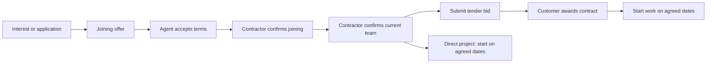

# Project invitations, joining and confirmed teams

An accepted invitation reserves the agreed work dates. The contractor confirms
joining separately, then reviews and confirms the complete team. A tender award
remains a separate decision. These stages are enforced by the API as well as
shown in the agent and contractor workspaces.

| Stage | Agent experience | Contractor action |
| --- | --- | --- |
| Invitation pending | Project, contractor record and own offer; accept or decline | Review applications and offer terms |
| Offer accepted | Reserved place, own role/pay/terms and joining progress | Confirm the accepted agent's joining |
| Joining confirmed | Joining confirmation; team formation progress | Resolve remaining offers and required roles |
| Team confirmed | Teammate names and designations, private congratulations | Submit a bid or prepare direct project work |
| Contract awarded | Separate award update; agreed work plan | Start within the agreed dates |
| Active project | Own attendance, own leave and permitted milestones | Manage delivery, reviews and project completion |

Work tools require the server's capabilities. In tender-backed work, confirming
a team does not unlock attendance or leave before an award. Attendance check-in
also requires an active project and the agreed time window. Open attendance can
still be closed safely if the roster later needs review.

## State and privacy

`confirm_joining` and `confirm_team` are contractor-only project commands with
version checks and replay receipts. Team confirmation is bound to the current
roster, joining confirmations, reporting roles and pending offers. Changing that
roster requires a fresh review. Team capacity and schedule conflicts are checked
again before confirmation, bid submission and award.

Agents receive a projection of the project, not the raw project record. Before
team confirmation, they see only their own invitation. Afterwards, peer rows
contain identity and designation fields; contact details, private pay/terms,
peer attendance, peer leave and private event notes remain excluded. Contractor
credibility uses recorded completed-project and milestone totals without
exposing past customer names, sites, budgets or project records.

New invitations always require the new confirmations. Existing ongoing legacy
memberships retain compatibility only when their accepted placement predates a
recorded project start or has actual recorded attendance. An old project status
alone does not confirm a new member's joining.

The wire-level application status `hired` remains for compatibility. Interfaces
must use the additional `joining_status` and `team_confirmed` fields to display
the current stage; an accepted offer must not be described as confirmed joining.

## Notifications and celebration

Joining confirmation writes a private in-app notice. Confirmed-team and award
notices use the existing bounded project update queue, deterministic recipient
IDs and durable push/mail queues. Every delivery rechecks the current membership
and confirmation. Revoked or outdated confirmations do not remain valid push
targets. Private team notices do not require or create public social sharing.

Public placement sharing still requires the member's consent and the current
confirmed team; tender placements also require the actual winning award.
Acceptance alone no longer publishes a placement.

The project updates bell opens the exact authorized project and records the
notice as read. The project screen celebrates each confirmation once per
account/confirmation on that device, with a storage fallback and reduced-motion
support. A pending tender decision is stated explicitly.

Push payloads contain only a validated project identifier, recipient identifier
and destination metadata with generic lock-screen text. Device notification
preferences and provider delivery still apply; queueing is not proof that FCM
or email reached a physical device.

## Release and verification

The focused backend and real HTTP/browser suites cover the stage transitions,
privacy, failed early work requests, source revocation, notifications, replay,
legacy ongoing work, mobile reflow and reduced motion. Existing tender and
private customer-contract flows must continue through award and completion.

Publish the matching API/work-service and website batch when a release is
requested. In addition to the hashed assets and entry metadata, the website
publication must include the changed static
`web/public/repaidians-work-push-sw.js`; an assets-only publication leaves old
push navigation installed. Preserve the live Apache configuration and verify
the service worker's published content hash. Native Android adapter changes
require a separately compiled and signed app build; source checks do not
establish that an installed APK contains the new route.
