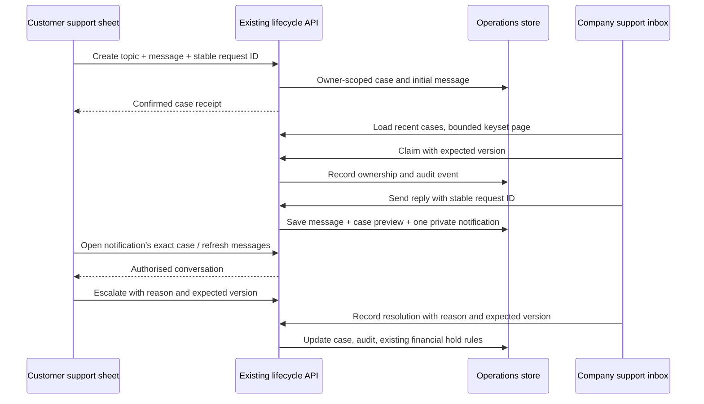

# Customer market, contributions and company support

This batch extends the existing marketplace, booking and lifecycle APIs. It adds
no deployed service, provider, recurring cloud job or new dependency. It includes
the preceding unreleased Captain rewards work on the development branch.

## Customer navigation

Bookings contains Visits, Home plans, Hiring, Contracts, Rides and **Contribute**,
in that order. The shared navigation keeps its selected item visible on small
screens. Existing booking notifications and links still select their own service
view. The Contribute section reuses the same customer-private records as Market:

- **Pickups:** request, collection travel, private camera evidence, inspection,
  itemised weighed quote, acceptance, actual buyer payment and receipt confirmation.
- **Reports:** public-place report, permission and reward review, collection,
  after evidence, verification and cash receipt when approved.
- **Points & rewards:** the existing verified ledger, levels, expiry, local rankings
  and funded coupon rules. Moving tabs does not create another points ledger.

`/?view=contribute` opens the new booking view. `contribution=reports` or
`contribution=rewards` chooses its panel. Cleanup notification links enter this
workspace; partner links continue to enter the scrap collector suite.

## Marketplace and rentals

The market header shows real destination banners with local image assets, manual
navigation and a persistent autoplay pause control. Playback pauses for keyboard
focus, hover, reduced motion, a hidden document or an off-screen carousel. Lottie
accents load only when the visible banner can animate.

Offers & coupons reads `/operations/coupons/wallet` for the signed-in account.
It displays the actual percentage, cap, expiry and terms. Copying a code does not
reserve or apply it; the user chooses it at eligible checkout. My rewards opens
the existing Captain panel. No fake price, discount, countdown or availability is
introduced by these marketing controls.

On phones, rental categories use a full-width horizontal row with stock counts.
The category hierarchy and detailed filters remain available in the filter drawer;
a desktop sidebar retains the nested tree. The drawer and row share filter state.
Cards, rate periods, availability and result counts still use the rental catalogue.
Selection, focus and hover use short transitions with reduced-motion alternatives.

## Private support and company CRM

The floating Help control sits above Bookings in the mobile navigation. It opens
a restrained glass support sheet with thin borders. Customers can choose a topic,
start a request, follow replies, escalate or reopen. The UI never invents online
staff, a typing indicator, delivery/read acknowledgements or response-time promises.
A message is marked saved only after the API confirms it.

Support drafts and uncertain submission IDs are scoped by account, role and case
in session storage. A case-list refresh cannot replace an active composer. A lost
submission response leaves the draft and original retry ID intact; retrying the
same intent returns the existing case. Account changes remove the old conversation
from the UI. Private case data does not enter public community or marketplace feeds.

The company inbox supports recent-case search, state and ownership filters,
assignment/release, conversation replies, escalation, recorded resolution and
older-page loading. Queue metrics explicitly describe the loaded cases. Each page
contains at most 100 cases (60 by default), ordered by update time and stable ID.
Firestore uses its indexed order and native document-reference cursor. Customer
case lists, case messages and financial-hold checks use account/case/job equality
queries rather than global collection scans.

A case assigned to a teammate rejects conflicting replies and resolutions on the
server. Case status actions check expected versions and recognise identical
retries. Resolution remains an admin action. Existing dispute, warranty, payment
and penalty financial holds remain in force; chat does not approve refunds or
impersonate customer consent.

The existing company workspace receives a compact CRM theme across its 17 modules:
smaller headings, tighter rows, consistent cards and fields, clearer navigation,
searchable workspace names, a Cmd/Ctrl+K shortcut, responsive menus and shared
light/dark tokens. Shop-partner styling is outside this company-theme change.

## API compatibility and validation

Existing `/operations/support`, `/support/{id}`, message, action and admin claim
routes are reused. New optional case metadata includes requester name, message
preview/count, last sender role and priority. Additional topics cover market,
rental, scrap, rewards, hiring and account queries. Booking-specific topics still
require an owned or assigned job. The admin list adds bounded `cursor`/`limit`
parameters and `next_cursor` while retaining its `cases` response field.

The new browser journey uses an isolated SQLite API. It checks contribution
records, customer/admin conversation, uncertain submission retry, private account
switches, rental filtering and actual account coupon eligibility. Existing company
regressions cover every admin module, failed/slow sources, cache reuse, role denial
and absence of navigation-triggered writes. Visual checks include 320px phones,
desktop, light/dark themes, 200% text, keyboard use, enhanced AAA text contrast and
reduced motion. No production accounts, tickets, payments or uploads are used.

The matching API and cPanel bundle must be released together after an explicit
release request. A local build is validation, not publication. This batch does not
claim production delivery, native background support notifications, full-text
search of every historic message or load testing beyond the checks performed.
