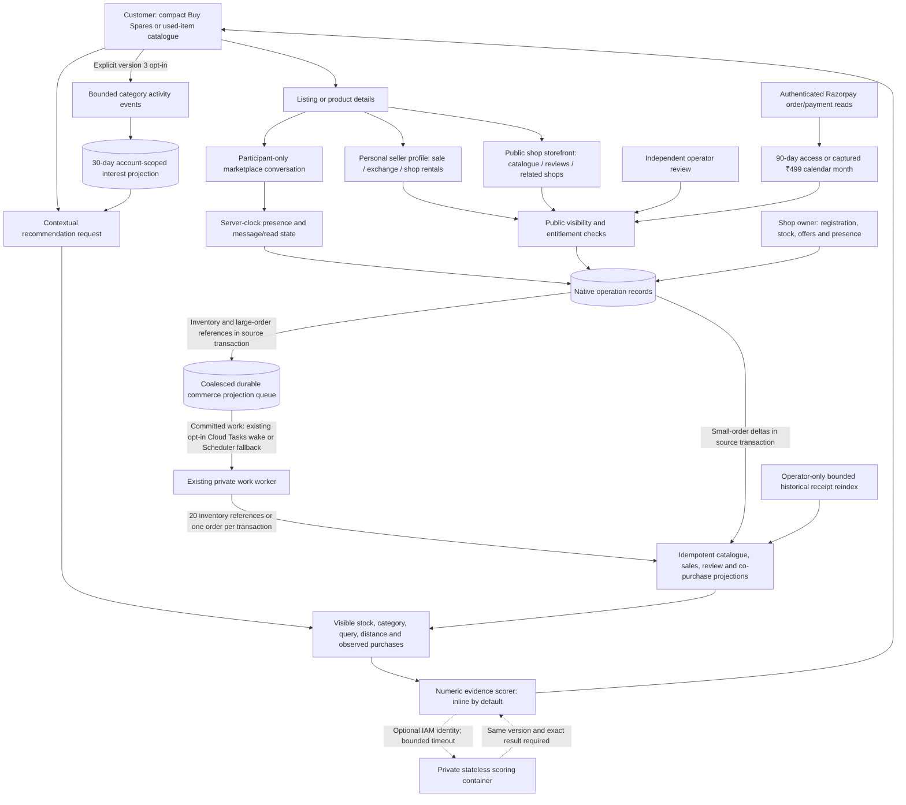

# Live marketplace profiles, presence and shop discovery

**Development implementation, 16 October 2026. This document does not describe a production rollout.** No deployment, cloud service creation, traffic switch, billing activation or operator backfill is implied by these changes. Production still needs an explicitly requested, verified release.

## End-to-end flow

The native API retains authentication, database access, visibility, stock reservations, payment authority, prices, reviews and order state. The optional scorer receives anonymous numeric evidence; it cannot publish a shop, spend rewards, set an offer, charge a customer or change an order.

## Personal seller profiles and navigation

`market_profiles.py` resolves a seller through an active public listing, or resolves the other participant through an authenticated conversation. There is no public lookup by account UID or an endpoint enumerating all sellers.

- Public entry: `GET /api/operations/market/profiles/by-listing/{listing_id}`.
- Conversation entry: `GET /api/operations/market/chats/{chat_id}/peer-profile`. A participant can inspect the peer's public catalogue after the conversation's original listing closes. A nonparticipant receives 404.
- Both accept `mode=all|second_hand|exchange|rentals`, `limit=1..24` and an opaque continuation cursor. A cursor is scoped to that profile and filter.
- Sale and exchange results contain only the same owner's currently published, unexpired listings. Shared-trial/access listings also require current entitlement. Individually paid legacy listing periods remain valid until their original expiry.
- Rentals come from the seller's approved, publicly visible shops. The platform currently has shop-owned rental inventory; personal rental ownership is not fabricated.
- The public response contains an opaque profile key, sanitized display name, public catalogue cards and shop references. It omits account IDs, phone numbers, email addresses, private home addresses, precise pins, bank records and private listing metadata. Personal marketplace membership does not grant an identity-verification badge.

The mobile modal has sale/exchange/rent filters, real item prices/photos, public counts, error/retry and empty states, 44px controls, keyboard focus, light/dark themes and reduced-motion support. Opening an item or shop closes the profile before navigation. Selecting a different listing re-enters its native details flow rather than replacing checkout or messaging behavior.

Queries use indexed owner/shop lookups. Item scans continue through sparse private rows with a 400-row work bound per request. Count previews examine up to 500 owner listings and up to 500 rental rows per visible shop; shop previews are bounded to 20. `counts_complete` and `shops_complete` disclose incomplete counts. Counts are lower bounds when incomplete; they are not global marketplace totals. `first_listed_at`, when present, is the earliest currently public listing in a complete preview, not an account registration date.

The profile HTTP response is `private, no-store`. The browser keeps a bounded 15-second read cache; conversation profile keys include the current account. Requests and renders reject late results from a previous account, reference or filter. Mutation events invalidate cached reads; manual refresh revalidates visibility.

The ₹499 plan governs the public shop storefront and Buy Spares visibility described here. The existing standalone rental catalogue and rental lifecycle retain their existing commercial rules; this change does not add a rental subscription or block management of an ongoing rental. Rental cards within a public shop/seller profile appear only while that shop profile is publicly visible.

## Live conversation details

`MarketInbox.tsx`, `market_messaging.py`, `market_presence.py` and `market_delivery.py` preserve native chat access, durable message commands, offers, unread counts, read receipts, blocking and reporting.

| API | Purpose / boundary |
| --- | --- |
| `GET/POST /api/operations/market/chats` | Participant inbox / open a listing conversation |
| `GET/POST /api/operations/market/chats/{id}/messages` | Cursor-based message history / durable idempotent message |
| `POST /api/operations/market/chats/{id}/read` | Mark confirmed displayed messages read |
| `POST /api/operations/market/chats/{id}/block` | Block/unblock the conversation |
| `POST /api/operations/market/chats/{id}/offers/{message_id}` | Accept/decline a native offer |
| `POST /api/operations/market/chats/{id}/report` | Report the conversation or a message |
| `GET/POST /api/operations/market/chats/{id}/presence` | Participant-only live state / authenticated heartbeat |

Presence means **active in this conversation**, not globally online or guaranteed available to trade. Each participant/thread has one bounded record with at most 16 browser sessions. Server-assigned online expiry is 45 seconds and typing expiry is 6 seconds. Monotonic session sequences prevent a delayed disconnect from overwriting a newer heartbeat. Blocked conversations reveal neither live nor last-seen state; typing also requires a verified phone, an active listing and current send capability.

The foreground chat refreshes new messages approximately every 3 seconds; inbox/unread reads run approximately every 15 seconds. Heartbeats normally run every 15 seconds, with typing updates limited to approximately 4-second intervals. The client debounces initial typing by 250ms and stops it after inactivity, blur, send, modal coverage, hidden tab, disconnect or close. Expiry still clears stale state when the browser cannot send a final disconnect. Server time plus browser monotonic elapsed time prevents local wall-clock changes from extending an online indicator.

Presence does not create messages, unread counts, charges or notifications. It needs no expiry scheduler. Push dispatch separately rechecks participant identity, block state, message sequence and read state before delivering a queued chat notification. An offline notice explains that the composer draft remains on the device. Existing message history stays readable after membership expiry; send capabilities remain subject to the separate ₹99 marketplace plan.

## Shop visibility, verification and pricing

These are separate authorities:

| State | Rule |
| --- | --- |
| Shop access | One 90-day period from the immutable registration timestamp, then ₹499 per calendar month, manually renewed |
| Public visibility | Approved shop plus active access; suspension or expired access hides its public catalogue/profile |
| Verified badge | Approved shop, an independent reviewer different from its owner, and all identity/business/address checks recorded true |
| Shop Prime | Existing ₹1,499 monthly paid-placement product; not renamed or silently replaced by access |
| Personal sale/exchange access | Existing shared 90-day period, then ₹99 per calendar month; separate from shop access |

A trial or captured access payment never verifies a shop. Legacy operator-approved records retain transitional visibility without receiving the new badge. Historical records use their existing `created_at`, `submitted_at` or `reviewed_at`; records with no date use the fixed migration epoch `1792108800` (16 October 2026, 05:30 IST). Reading a status never restarts a trial. The original active Prime interval remains an access bridge for compatibility; Prime is still labelled paid placement and adds no evidence-rating points.

Access routes are `GET /api/operations/shop/access`, `PUT .../settings`, `POST .../order` and `POST .../check`. A phone-authenticated owner and exactly one registered shop are required. Payment attempts are idempotently tied to owner/shop/request, provider order receipt/notes, INR amount and captured payment. Provider GET reconciliation, not the checkout browser callback, grants a month. Partial/full refunds remove the relevant grant. Calendar months use Asia/Kolkata and clamp a missing day to month end; access does not auto-debit. At most 12 prepaid intervals are accepted.

For **new spare parts**, `shop_pricing.py` projects an owner-funded effective price without overwriting base inventory prices or historical paid receipts:

1. An explicit active positive merchant percentage offer replaces the default offer; percentages are limited to 25%.
2. Otherwise, a dated shop registration receives the default 5% offer during its 90-day period. Owners cannot disable that default during the trial.
3. After the period, the owner can turn it off through versioned settings. Historical undated shops do not receive a newly invented automatic discount; an explicit owner opt-in can enable it.
4. Integer-paise discount is `min(floor(base × basis_points / 10000), max(0, base − declared_floor))`. The declared minimum selling price is always honored, so a floor can reduce the visible effective percentage.

`PUT /api/operations/shop/products/{product_id}/offer` requires ownership, approval, new-item condition and the expected inventory version. The same projection feeds the public catalogue and native quote/checkout price snapshots. Checkout requires the expected total again and returns a price-change error if it changed. Existing coupon/reward eligibility, taxes, stock reservation and payment verification remain server-owned; this change does not turn new spares into reward-eligible refurbished stock or invent MRP.

## Public shop storefront and recommendations

| API | Actual behavior |
| --- | --- |
| `GET /api/operations/products/catalog` | Visible native product catalogue with effective offers |
| `GET /api/operations/shops/{shop_id}/profile` | Public storefront, bounded catalogue, real reviews, rental previews, activity, evidence metrics, sampled rank and related shops |
| `POST /api/operations/shop-discovery/recommendations` | Anonymous current-context suggestions |
| `POST /api/operations/shop-discovery/personal` | Authenticated suggestions; behavior signals used only with version 3 consent |
| `POST /api/operations/shop-discovery/recommendations/personal` | Compatibility alias for the previous route |
| `POST /api/operations/shop-discovery/events` | Consented bounded category-event recording |
| `POST /api/operations/shop-discovery/presence` | Phone-authenticated shop-owner session state |
| `GET /api/operations/shops/{shop_id}/reviewable-orders` | Current customer's qualifying unreviewed receipts |
| `POST /api/operations/shops/{shop_id}/reviews` | Verified received-purchase review |
| `POST /api/operations/admin/shop-discovery/reindex` | Operator-only historical receipt projection, one receipt per page |

Storefront sorting supports relevance, bestselling, top rated and ascending effective price. Catalogue work is bounded to 100 candidate rows per window; pages contain up to 24 cards and continue to another keyset window when necessary. Sorting and bestseller/top-rated ordering apply to the current window, with explicit coverage, rather than claiming a complete catalogue-wide order. Bestselling uses observed received units; top rated uses confidence-adjusted purchase ratings. Product eligibility requires approved visible shop stock with a fresh native stock confirmation. A stock or access failure removes a candidate before scoring.

The discovery engine considers current category/product/query, optional chosen city/location, opted-in category interest and observed received sales. Product ordering uses query token relevance, capped category interest, distance when supplied, received units and stable ID ties. It excludes the seed product and items already in the provided cart. Up to 12 related products and 6 shops are returned. Related shops on a storefront are drawn from a bounded matching city/category cohort, not a claim to search every shop in India.

Shop presence is a separate public owner-observation feed. Sessions expire after 90 seconds, accept monotonic sequences, and are bounded to 8 live sessions / 16 retained session slots. Expired evidence displays “Status unavailable,” not a fabricated offline claim. Monthly active days count distinct observed Asia/Kolkata dates; missing history is unknown. They do not represent hours worked, all visits or sales. Presence and subscriptions are not score inputs.

## Evidence model and mathematical limits

Version `commerce-evidence-v1` uses the following transparent numerical features:

| Component | Maximum points | Calculation |
| --- | ---: | --- |
| Verified purchase reviews | 40 | `(Bayesian rating / 5) × confidence × 40` |
| Fulfilment reliability | 20 | `(received / observed terminal outcomes) × outcomes/(outcomes+5) × 20` |
| Received purchases | 15 | `min(log(1+received)/log(101), 1) × 15` |
| Current category/search match | 15 | Bounded context match × 15 |
| Fresh stock | 5 | Fraction of relevant approved in-stock catalogue rows confirmed within 24 hours × 5 |
| Measured response time | 5 | `1/(1+average_seconds/3600) × min(response_count/5,1) × 5` |

With rating sum `s` and review count `n`, Bayesian rating is `(s + 3.5×5)/(n+5)` and confidence is `n/(n+5)`. A new unreviewed shop has no displayed customer rating; the prior is not fabricated customer feedback. The shop discovery adapter currently supplies **zero response observations**, so response points stay zero until genuine response evidence is instrumented. Online time, registration payment, Prime payment, customer identities, customer revenue and sensitive personal traits contribute no points.

A review requires the authenticated customer's own paid, captured, confirmed received, non-refunded purchase from that shop. Owners cannot review themselves. There is at most one shop review per order, with optional attribution to a product actually purchased. Replaying the same command is safe; changing it conflicts. A later refund retracts the purchase/review contribution.

Public rank is explicitly **rank among matching shops in a sample**, using at most 24 candidates. The response includes position, cohort size, candidate limit and sampled coverage. It is not a global rank, an availability guarantee or a claim of statistically exhaustive quality.

“Frequently bought together” requires at least 5 observed received seed-product orders and at least 3 received orders containing the pair. Confidence is `pair_received_orders / seed_received_orders`; up to 4 eligible results are shown. With insufficient evidence, the surface is labelled **Related items**. Pair projections use at most 8 distinct products per receipt to bound transaction writes; large baskets do not imply complete pair coverage.

## Consent, caching and projections

Marketplace behavior uses `GET/PUT /api/operations/discovery/preferences` with `consent_version: 3`; `POST .../preferences/reset` starts a fresh consent epoch. Earlier service-discovery consent alone does not authorize marketplace-history personalization. Anonymous and opted-out requests retain useful current-context suggestions.

Only normalized category signals are retained, for at most 30 days and 20 categories. Search/product/shop events add 1, add-to-cart adds 3, retained category score is capped at 20 and recommendation interest influence at 10. A bounded request-fingerprint ledger prevents replay inflation and accepts at most 100 recent event commands per day. Raw searches, precise pins, IP addresses, cart contents and sensitive profile traits are not stored in the interest projection. Opt-out/reset clears retained signals and fingerprints; consent epochs prevent old signals being revived by a later opt-in.

Browser public catalogue/profile/recommendation caches are bounded and normally fresh for 30 seconds. Personal caches are account/consent scoped and clear on identity, interests or mutation changes. A malformed response becomes a recoverable loading error. Cached presence carries its original server observation and expires locally rather than becoming “live” again on each cache read.

`operations.Unit.put()` keeps consent erasure synchronous and coalesces inventory-summary updates into a durable `commerce_projection_queue` envelope in the same native source transaction. The envelope contains bounded document references and progress offsets, not customer records, addresses or whole basket payloads. Multiple line-item updates share an envelope with at most 200 references; workers rehydrate committed current records rather than replaying a stale snapshot. Time-prefixed random envelope IDs provide a stable work order without exposing customer identifiers. Small retail-order projections remain synchronous. Orders with more than 8 lines, more than 4 shops, or an already large transaction (`u.pending` over 150 documents) are queued to protect the source transaction write budget.

The existing private `/internal/work/dispatch` worker drains commerce work alongside its other native queues. Each drain transaction handles at most 20 inventory references **or** one retail-order reference, then atomically advances the envelope. A worker request runs at most 10 such steps; the existing native Scheduler fallback runs at most 2. Active queue writes set `work_events`, so the existing post-commit, opt-in Cloud Tasks dispatcher can wake that same worker. Wakeups are coalesced into 10-second task-name buckets; no customer payload is sent. If opt-in dispatch is disabled or unavailable, the durable queue remains for the existing Scheduler path. There is no new always-running queue consumer, scheduler or automatically deployed service.

`commerce_order_projection` records prior contributions, so repeated or reordered envelope delivery produces deltas rather than double-counted sales/reviews/pairs. Progress commits only with projection changes; a failed transaction leaves work active for retry. A completed envelope is atomically deleted with the final projection, so inactive reference ledgers do not accumulate or depend on a background TTL sweep. These queued aggregates are eventually consistent, while native stock reservation, effective checkout prices, payment authority and order state remain synchronous. An observation start and explicit public history coverage prevent a delayed or unbackfilled projection being presented as complete lifetime sales.

The native 100-line / 100-supplier checkout, capture and received-order regression records a maximum **404 source document writes**, below the Firestore 500-write transaction cap. The same regression preserves all 101 customer/supplier confirmation recipients. This is a measured fixture bound for that critical source path, not a blanket guarantee for arbitrary bulk administrative writes. Projection drains have independent per-transaction bounds and replay/refund tests.

The operator reindex endpoint processes one receipt per request and returns a cursor. It uses the same idempotent projector, accepts only the existing operator boundary and does not run automatically during public browsing or this development work.

## Optional scoring container and operations

`backend/Dockerfile.commerce-ranking` builds a non-root, minimal image containing the numeric model, private service and transport boundary only. It has no native database/storage adapter. `/internal/commerce/rank` accepts at most 64 strict numeric candidates; `/health` reports service/model version. The service checks the configured audience and exact verified Google service-account identity. The caller permits HTTPS Cloud Run origins, refuses redirects and sends no native records or PII.

With `REPAIDO_COMMERCE_RANKING_URL` unset, scoring stays inline. If configured, service identity discovery runs in one bounded background refresh worker; at most two remote requests run per process. Remote calls have a one-second deadline, a bounded response and a 30-second failure backoff. A version mismatch or any output difference from the local deterministic model falls back to the local result. The remote service has a bounded 128-entry / 60-second anonymous feature cache.

A future explicitly authorized Cloud Run deployment should use **minimum instances 0**, private invocation and bounded maximum instances. No always-running scorer, new scheduler, public inference endpoint or scorer deployment was enabled by this change. Separating the scorer is an optional scaling boundary, not a claim that a network hop improves deterministic ranking quality or makes every request cheaper.

Expected failures are explicit: 401 sign-in, 403 phone/ownership/approval, 404 unavailable resource or unauthorized chat reference, 409 stale versions/reused commands/payment review, 422 invalid cursor/input and 429 bounded presence/rate limits. Payment providers unavailable return 503 without granting access. The existing native scheduler reconciles a bounded batch of unfinished shop-access payments and reports attempted/error counts; it does not grant access merely because time elapsed.

Queue drain responses report `processed` and `continued` step counts; `continued` is not the total backlog size. The worker response includes its commerce result. Existing work-event logs report accepted/deferred provider status without record contents; a failed wakeup preserves the durable envelope. Access captures/refunds and offer/settings changes emit native audit events. Optional scorer failures emit fixed warning messages identifying inline fallback, without tokens, request payloads or customer content. Presence is deliberately ephemeral and does not emit marketing notifications. These mechanisms complement existing API logs and scheduler results; this batch does not add a new monitoring platform, latency SLA, historical backfill completion guarantee or globally accurate ranking claim.
