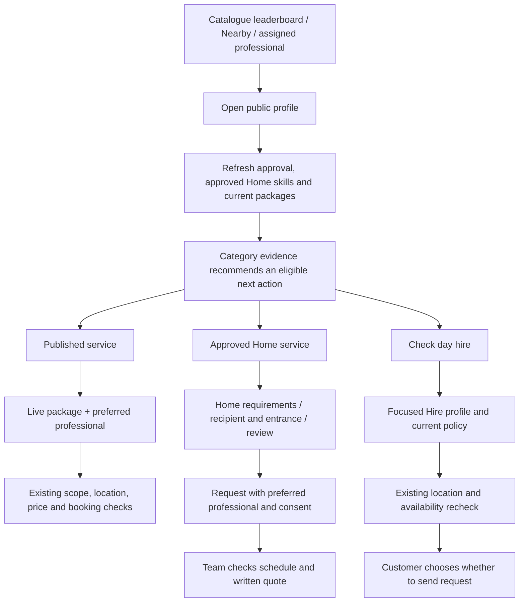

# Professional profiles and Repaido Home

This development batch builds on the unreleased Market, Contribute and support
work. It changes no production deployment, automatic trigger or cloud capacity.

## Customer decision flow



Profiles share the same compact presentation across the catalogue, nearby
discovery, the Hire directory and an assigned professional's tracking view.
Current profile details must load successfully before quick actions appear.
Opening a profile or choosing “Check day hire” does not submit a booking.
Catalogue requests retain the chosen professional as a preference; assignment
still follows the existing server checks.

The header uses real reviewed status, rating and review counts. Category ratings
remain distinct from overall results. Skills, languages and equipment use short
inline rows; full prices, reviews and commitments stay in disclosures. Work and
review cards use a square minimum and grow when enlarged text needs room. Their
rail supports keyboard scrolling, manual controls and permanent pause. Reduced
motion disables automatic movement.

Current category evidence, approved Home services and catalogue packages order
the actions. Neither a score nor a past rating establishes current demand or
future availability. Bounded historical evidence is explicitly labeled; coherent
native overall totals remain distinct from that sample. See the detailed
[ranking and container design](hiring-profile-recommendations.md).

## Repaido Home boutique

The Home entry contains an independent photo frame, specialty branding and a
single discovery action. Existing local photos rotate only while visible and
outside a background modal. Manual selection, focus or hover pauses playback;
the user can explicitly resume it. The pause preference synchronizes mounted
frames and survives reloads. Operating-system and app reduced-motion preferences
remain respected.

The boutique keeps the existing Home catalogue and three request stages. Cards
separate recurring care from scoped projects. Published small-job prices come
from the live regular-service catalogue, and Home plans remain quote-first.
`Service.price` contains paise in this repository; `59900` displays as ₹599.00.
The selected Home category queries reviewed professionals before the bounded
leaderboard limit, avoiding a misleading all-trades top-results filter.

An incoming preferred professional applies only to their originally selected
Home service. Switching to another offering clears that preference. The final
request still requires the structured brief, recipient details, checked entrance
pin and consent. Map callbacks keep address/city in their own form fields and
serialize only latitude and longitude into the strict API location object.
The actual quote, approval, calendar, payment and service lifecycle APIs remain
in charge of later stages.

## Verification and release

Local browser checks use an isolated SQLite API or explicit fixture boundaries;
they never create production bookings or uploads. The profile/Home journey
checks real public profile responses, a package's professional preference,
request submission, preference isolation, and the day-hire navigation guard.
Separate Home checks cover all request stages, actual price units, motion,
offscreen/modal pauses and retained pause preferences. Responsive checks include
320px phones, desktop, light/dark themes, 200% text and enhanced text contrast.

Useful local commands, after starting the existing Vite development server:

```sh
cd web
npm test
npm run build:cpanel
PLAYWRIGHT_MODULE=/path/to/playwright node tests/professional-home.browser.mjs
HOME_BOUTIQUE_ORIGIN=http://127.0.0.1:5187 node tests/home-boutique.browser.mjs
HOME_BOUTIQUE_ORIGIN=http://127.0.0.1:5187 node tests/home-boutique-motion.browser.mjs
```

The professional/Home runner starts and removes its own disposable API on port
8075. Browser tooling paths are local environment selectors, not production
configuration. A local cPanel build validates the bundle without publishing it.
Release matching API and website changes together only when explicitly requested.
The optional ranking container is built and tested locally; enabling it in Cloud
Run remains a separate release action. Lightweight inline ranking is the default,
with no claim of measured cloud savings or deployed traffic capacity.
