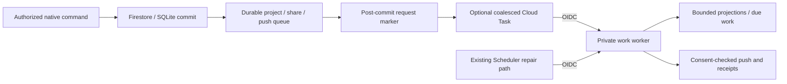

# Repaidians professional workspace and fast browsing

This development batch retains loaded content, connects the existing
professional tools, and adds optional independently scalable runtimes. It does
not enable a cloud service, change production traffic or allocate a queue.

## Professional tools

Work & market → Professional tools → Overview shows the current professional
profile, availability, recorded publications/connections/followers, an eight-item
profile checklist and a bounded preview of recent connection invitations. Each
action opens the existing native flow: profile editing, career background,
jobs, applications/offers, contracts, companies, network, publishing, saved
posts or preferences. Availability writes the actual profile state. Sharing a
profile produces a Repaido URL that opens that member's profile after current
access checks.

`GET /repaidians/professional/workspace` requires a signed-in, currently approved
professional with community access. Its reads use the caller's own record and
a maximum of 32 connection references; the invitation preview is not an exact
global pending count. Profile completion measures supplied fields, not verified
qualifications. Contact details and unrelated users' private records are absent.

## Loading and cache contract

| Layer | Behavior | Retire / recheck |
| --- | --- | --- |
| Cold start | `GET /repaidians/bootstrap` returns compact access metadata, one selected feed page and optional stories in one transaction/request | Account, role and membership are checked on the server |
| Timeline session | Six loaded timeline windows, pagination cursor, members, stories and scroll positions stay in browser memory | Explicit refresh, content/privacy change, identity change or memory eviction; windows above 240 items are not retained after closing |
| People / marketplace | Loaded results and pagination are retained in bounded session views; people search has an explicit refresh | Intentional refresh or relevant invalidation; mounted marketplace revalidation remains quiet |
| Work / network panels | A retained snapshot renders immediately while the current read revalidates | Current user and generation guards; access errors remove protected data |
| Current feed records | `POST /repaidians/feed/validate` updates known records without fetching/reordering timeline pages | Visible-tab check every 30 seconds, at most 100 IDs per request; larger windows rotate through batches |
| Private media | A 32 MiB / 64-entry blob cache keeps bytes; expired entries use ETag conditional requests | Server still checks block/deletion/trade/trial before 304; authorization deadline is 60 seconds |
| Static web assets | Existing hashed production assets retain the Hosting caching policy | New build changes hashes |

Retained views never enter localStorage, IndexedDB or a shared CDN. A warm reopen
still obtains current access metadata before exposing its saved window. Source
listing details remain authoritative, and commands recheck price, ownership,
capacity and current status. Loaded public content does not automatically insert
new posts ahead of the user's scroll; the timeline refresh action does that.

Likes, private messages, work actions and network updates no longer discard
unrelated browsing windows. Behaviour receipts invalidate the interest read,
not every application/company result. SDK sign-out does not fall back to an old
legacy credential. Snapshot generations prevent a late response from being
filed under a later account.

## Search

Member discovery uses a bounded prefix lane, then requires every query term to
match public name/handle text. Reversed name order works. Before full worker,
badge and relationship hydration, the existing content-digest-versioned Bloom
filter and exact prefix postings remove impossible candidates. Bloom positives
never create a result, and authorization/availability never lives in that cache.
Trade/city/status/type filters remain server checked. This endpoint searches
names/handles, not arbitrary private biography text. Work discovery retains its
existing native trade/skill/experience matching and consented interests.

## Optional traffic separation

| Runtime | Normal / optional use | Scaling contract |
| --- | --- | --- |
| Main API | Default serving path for social/community routes and native Repaido commands | Existing limits remain |
| Work API | Existing independently deployed jobs/contracts/company discovery | Existing request admission and scale-to-zero configuration |
| Community API | Optional `community_service:app`, including social, network, opportunity, membership and tools routes | Candidate deploy uses min instances 0, max 20, concurrency 32, 1 CPU / 512 MiB |
| Work worker | Existing private `work_worker:app` | IAM + exact OIDC caller/audience; no public Hosting route |

`scripts/deploy-work-services.py` includes a community candidate only when the
parent runtime configuration explicitly sets `REPAIDO_COMMUNITY_API_ENABLED=true`.
It uses the same tested immutable image and checks health plus an authenticated
professional route before promotion. It excludes mailbox secrets from public
runtimes; community keeps its required Cloudflare configuration while the work
API does not receive it.

Activation is a requested release operation. After verification, add
`/api/repaidians/**` → `repaido-community-api` before the generic `/api/**` rewrite,
keeping the more-specific work/company/placement rewrites first. The default
checked-in Hosting file continues routing community to the main API. Reverting
that rewrite restores the default path while native state remains shared.

A service is not created and destroyed for each spike. A preconfigured Cloud
Run service starts instances on requests and can return to zero when idle. Cold
starts and per-instance in-memory caches still exist. Choose traffic separation
using measured latency, saturation, Firestore operations and request cost;
concurrency settings are not throughput certification.

## Optional event wakeups

Event submission defaults off. Required configuration is:

- `REPAIDO_WORK_EVENT_DISPATCH_ENABLED=true`
- `REPAIDO_WORK_EVENT_QUEUE=projects/<project>/locations/<region>/queues/<queue>`
- `REPAIDO_WORK_EVENT_WORKER_URL=https://<existing-worker>.run.app`
- `REPAIDO_WORK_EVENT_CALLER_EMAIL=<existing-authorized-caller>@<project>.iam.gserviceaccount.com`

Provision/verify Cloud Tasks and the queue during an explicitly requested
release. The submitting API identity needs task creation on that queue and
permission to act as the configured caller; the caller needs invoker on the
worker and must match its existing application-level Scheduler identity. Use
a queue dispatch concurrency of one and measured rate/retry limits. The handler
still limits work to 40 records and protects its single local dispatch slot.

Only a committed active outbox write signals dispatch. Rolled-back transactions,
ordinary reads and idle requests do not submit tasks. Submission occurs after
the HTTP response body, uses a two-second provider request timeout, and is
limited to one attempt per process/ten-second bucket. Deterministic task names
coalesce multiple instances; HTTP 409 is an accepted duplicate. The task carries
only `{"limit":40}`, never private event records, device tokens or credentials.

Provider failure leaves the outbox intact. The existing authenticated minute
Scheduler remains the recovery and time-based reminder path. At-least-once
delivery, stable notification IDs and server rechecks still apply. Neither
source configuration nor a queued notification proves device delivery or sound.

## Verification

Backend tests exercise one-request bootstrap, private-data retirement,
block/delete revalidation, native invitation/checklist data, multiword search,
separate runtime routes, post-commit dispatch and optional candidate deployment.
Web tests cover cache deadlines, generations, SDK sign-out, ETag reuse and
scoped event invalidation. The real SQLite/API/browser suite exercises loaded
pagination, scroll and reopen retention, professional availability and tool
handoffs, mobile/desktop, dark/light, 200% text and enhanced text contrast.

`web/test-results/repaidians-performance.json` records the local browser's
bootstrap-to-content and warm-return times. The completed real-API browser run
recorded eight bootstrap samples of 36–187 ms and a multi-page warm return of
296 ms. Timing begins with the bootstrap HTTP request, after JavaScript setup;
it does not include a first visit's script download. Those measurements exclude a live
Cloud Run/Firestore/provider audit and cannot guarantee a production 1–2-second
SLO. Validate the production p50/p95 after the requested release, including
cold instances and India-network conditions. No million-request capacity claim
or automatic infrastructure rollout is made by this batch.
