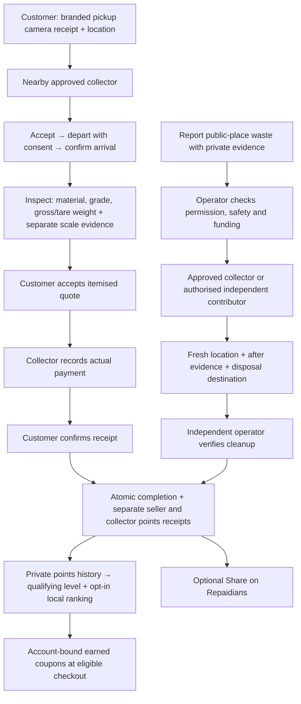

# Scrap, cleanup and Captain rewards

This development batch joins the customer's Sell scrap area, the scrap buyer's
collection suite, the public-place cleanup mission and Repaidians. It does not
deploy any service or create another always-running worker.

## Contribution lifecycle



A request, photo upload, unverified report, pending payment, reaction or post does
not award points. The completed scrap receipt remains open after the record moves
from an active filter into History. The buyer's dashboard labels money as **Paid
to scrap sellers**, separately from their contribution points and the reporting
customer's company-funded cleanup reward.

Location publishing continues while the collector changes panels or closes the
task sheet after explicitly starting the journey. It pauses when the browser is
hidden or offline and stops for completed, cancelled or unauthorised records.
This web implementation does not promise background location after the app closes.

## Points and badges

| Level | Qualifying points in the last 30 days | Coupon cap multiplier |
| --- | ---: | ---: |
| Contributor | 0–29 | Coupons unlock at Gold |
| Bronze | 30–59 | Coupons unlock at Gold |
| Silver | 60–99 | Coupons unlock at Gold |
| Gold | 100–199 | 1× approved Gold limit |
| Platinum | 200–399 | 1.25× approved Gold limit |
| Diamond | 400+ | 1.5× approved Gold limit |

Each eligible verified contribution awards **10 points to each distinct eligible
participant**. A reporter who cleans their own authorised report receives one
award, not two. The account's shared daily maximum is **50 points**, across sales
and public cleanups, using India-time calendar days. Splitting sales between the
same seller and collector on the same day creates no extra points. Each receipt
explains an applicable zero-point result, such as the daily limit or a repeat pair.

Awards are idempotent. Concurrent awards for an account conflict on the same
profile projection and recheck eligibility inside the transaction. Financial
completion still succeeds for older collections without the new reward evidence;
those records explain why points were not issued.

Qualifying points are the sum of valid, non-revoked awards younger than 30 days.
Future timestamps, non-finite dates and negative points do not qualify. Gold and
higher levels require at least 100 current qualifying points; lifetime or retained
ranking points cannot unlock coupons. The interface shows progress, points
available today, upcoming expiry and a private award history.

Leaderboard points use each award's age independently:

- Days 0–30: retain 100% of that award.
- Days 30–60: decline linearly from 100% to 30%.
- Day 60 onward: retain a 30% ranking floor.

For award age `a` in seconds and points `p`, the ranking contribution is
`p × max(0.3, 1 − 0.7 × (a − 30 days) / 30 days)` after day 30. The sum is floored
to an integer. A new contribution does not reset the age of old awards. Ties use
scored contribution days, scored contribution count, then a stable public ID;
zero-point receipts cannot inflate those tie-breakers.

## Verification and privacy

The published rules cover independent review, collection permission, public-place
declaration, safe material, before/after evidence, distinct photos, uploader
ownership, evidence claims, authorised collection, disposal records, review notes,
location distance, accuracy and freshness, submission ordering, once-only awards,
daily limits, qualifying age, decay and retained points. Scrap sales also require
customer-confirmed receipt, a different approved collector, the collection's
camera receipt, arrival, collector-owned scale evidence, positive weights and an
agreed payment matching the quote. These are explicit checks, not a hidden
behavioural score.

Leaderboards are opt-in. A user's city comes from their verified contribution;
clients cannot select an arbitrary ranking city. Public rows contain a display
name, optional separate profile photo, level and ranking statistics. Pickup,
weighing and cleanup evidence cannot be repurposed as profile photos. Addresses,
phone numbers, payment references, evidence URLs and private account IDs stay out
of public rankings and milestone cards.

Repaidians cards distinguish a report awaiting review from a verified cleanup.
Only participants can publish a source milestone. Sharing adds **zero** points.
The community banner links directly to Sell scrap, Report a spot and My rewards.
Text-only milestone posts do not display a misleading missing-media block.

## Funded coupon policy

Repair visits stay at **30%**, without stacking another visit offer. Current
checkout integrations cover:

| Offer | Eligible charge | Discount |
| --- | --- | ---: |
| CAPTAINREPAIR30 | Repair/service visiting base | 30% |
| CAPTAINHIRE20 | Professional day-hire base | 20% |
| CAPTAINRENT10 | Tool/heavy-vehicle rental usage base | 10% |
| CAPTAINREFURB25 | Qualifying refurbished appliances | 25%, at most ₹1,000 |

Cab base and first shared-ride offers are visible as inactive. Their cash/subsidy
checkout integration is not complete, so the server rejects attempts to activate
them. This batch does not silently reduce a driver's cash receipt or advertise an
unavailable transport saving.

The operator's cleanup workspace includes **Captain levels, coupon limits &
funding**. Proposed rupee caps are drafts, not active commitments. An operator sets
an approved monthly Repaido budget, a funding reference, enabled offers, the Gold
cap and each offer's absolute maximum. They explicitly approve and save the
policy. Concurrent edits use expected versions; identical retries are safe. The
policy is audited, and a budget cannot fall below already-reserved rewards.

The existing, previously approved appliance offer continues if no policy has ever
been configured. Saving a policy replaces that standing configuration; the form
explains this before approval. All other offers remain unavailable without a
funded policy.

The calculation is deterministic and uses integer paise:

1. `tier cap = min(floor(Gold cap × level multiplier), approved offer maximum)`.
2. Clamp appliance caps to ₹1,000.
3. `available cap = min(tier cap, remaining company budget this month)`.
4. `saving = min(floor(eligible base × percentage), available cap)`.

A single monthly budget document serialises reservations across accounts. Each
account can reserve an offer once per rolling 30 days. A durable per-checkout
ledger makes retries return the same result and rejects a changed code, scope or
base. Reservation counts as use and consumes the month's available funding;
cancellation does not automatically restore that reservation in this version.
Offers do not stack. Travel, tax, delivery, deposits, parts and extras are excluded.
The customer's final saving is reserved on the server, not trusted from a preview.

Repaido-funded savings have their own accounting field and expense journal line.
They do not reduce the professional's or supplier's agreed payable. Hiring quotes
include the discount before confirmation and apply it once. Rental extensions
cannot increase a company-funded discount beyond its original reservation.

## Loading, feedback and cost

- Reuse the existing account-scoped request cache and background refresh hooks.
- Point summaries refresh every 30 seconds while active, with an immediate cached
  render; detailed open collections refresh without replacing the whole list.
- No save confirmation on passive polling. Forms show their own submission phase,
  specific failure and durable completion receipt.
- A lost weighing response is verified against its exact command receipt before
  success is shown. An unconfirmed retry retains the original command ID.
- Wallet checks use account-indexed queries instead of scanning all bookings,
  rentals, invoices or sales.
- No new cloud build, revision, paid provider or deployed microservice is required
  by development or local verification. Existing release guards remain in place.

## Verification and next release

Local checks exercise real isolated SQLite transactions and HTTP routes; provider
calls are stubbed, and browser traffic cannot create production records.

```bash
cd backend
REPAIDO_STORAGE=sqlite .venv/bin/python -m pytest -q --tb=short
cd ../web
npm test
npm run build:cpanel
# With a Vite preview running on port 5186 and Playwright available:
node tests/scrap.browser.mjs
node tests/cleanup.browser.mjs
node tests/scrap-ecosystem.browser.mjs
```

Browser coverage includes customer capture, collector weighing, lost responses,
payment confirmation, points for both parties, live tracking after closing a task,
independent cleanup verification, cash receipts, avatars, local rankings, public
sharing, funded hiring coupons and account changes. Affected screens are checked
at mobile and desktop widths, light/dark themes and 200% text size, with automated
WCAG checks including enhanced AAA text contrast and reduced motion.

The next explicitly requested production release must include the matching API
container and cPanel web bundle. `captain_policy.py` is included in the container
COPY list and required source inventory. Do not publish the matching website
before its APIs are verified. No Firestore rule change, schema migration, Android
signing change or new secret is required by this batch. Local checks do not certify
production accounts, provider availability, background native location or load at
an untested traffic volume.
